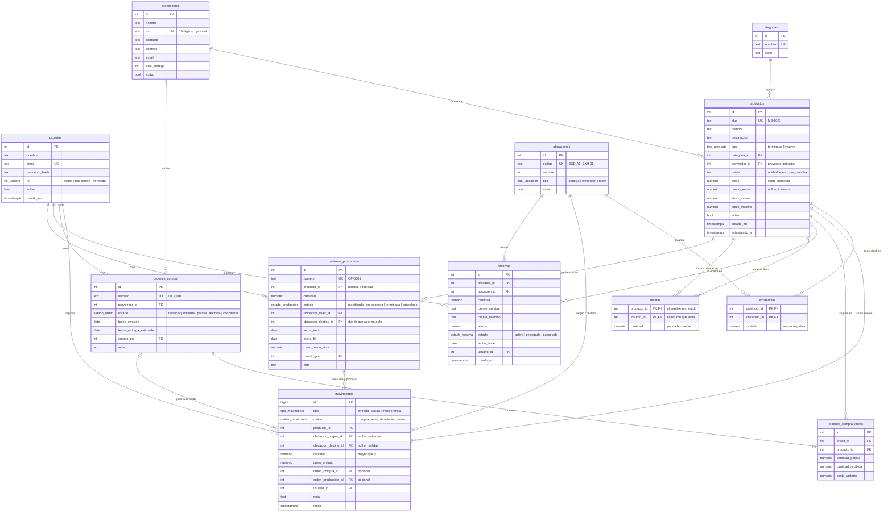

# Modelo de datos

Base de datos: **PostgreSQL 18**, base `inventario_muebleria`.
Las tablas se crean con **migraciones de Alembic** a partir de los modelos de SQLAlchemy (Fase 2). Este documento es el diseño de referencia.

## Diagrama

## Las tablas en una frase

| Tabla | Qué guarda |
|---|---|
| `usuarios` | Quién usa el sistema y con qué rol. |
| `categorias` | Sala, Comedor, Dormitorio, Oficina, Exterior, Insumos. |
| `proveedores` | A quién se le compra. |
| `ubicaciones` | Dónde puede estar algo físicamente: bodega, exhibición o taller. |
| `productos` | El catálogo: muebles terminados e insumos. **No guarda el stock.** |
| `existencias` | Cuántas unidades hay de cada producto **en cada ubicación**. |
| `movimientos` | El historial de todo lo que entra, sale o se traslada. Nunca se edita ni se borra. |
| `ordenes_compra` / `_lineas` | Pedidos a proveedores y lo que se ha recibido de cada uno. |
| `reservas` | Muebles apartados por un cliente con un abono. |
| `recetas` | La "lista de materiales" de cada mueble: qué insumos lleva y cuánto de cada uno. |
| `ordenes_produccion` | La fabricación de N muebles en el taller: consume insumos y produce muebles terminados. |

## Decisiones de diseño (y por qué)

1. **El stock vive en `existencias`, no en `productos`.** El mismo sofá puede tener 2 unidades en exhibición y 4 en bodega. El stock total es la suma de sus filas.

2. **Los movimientos son un libro contable.** Cada cambio de stock es una fila nueva en `movimientos`; las filas nunca se editan. Si hubo un error, se registra un movimiento contrario. Así siempre se puede reconstruir el **kardex** de un producto.

3. **Movimiento y existencias cambian en la misma transacción.** El backend inserta el movimiento y actualiza `existencias` dentro de una sola transacción, bloqueando la fila con `SELECT ... FOR UPDATE`. Si algo falla, no se guarda nada. Además, `CHECK (cantidad >= 0)` en `existencias` impide que el stock quede negativo, aunque el código tenga un error.

4. **Los tipos de movimiento definen qué ubicación es obligatoria**, con un `CHECK` en la tabla:
   - `entrada`: solo destino (compra, devolución de un cliente, ajuste positivo por conteo).
   - `salida`: solo origen (venta, daño, consumo en el taller, ajuste negativo).
   - `transferencia`: origen y destino distintos (de bodega a exhibición).

5. **Las cantidades son `numeric(12,2)`, no enteros.** Las telas se miden en metros (por ejemplo 2,5 m). Para muebles simplemente se usan números enteros.

6. **El dinero es `numeric(12,2)`, nunca `float`.** `float` tiene errores de redondeo (0,1 + 0,2 ≠ 0,3).

7. **El costo es promedio ponderado.** Con cada entrada por compra se recalcula `productos.costo`. El valor del inventario es la cantidad por el costo.

8. **Disponible no es lo mismo que en stock.** Disponible = existencias − reservas activas. Un sofá apartado sigue físicamente en la tienda, pero no se puede vender a otro cliente.

9. **Las variantes son SKUs separados (por ahora).** "Sofá 3 puestos gris" y "Sofá 3 puestos azul" son dos productos. Es más simple, y una tabla `variantes` se puede agregar después si hace falta.

10. **La fabricación se registra con los mismos movimientos.** La mueblería fabrica sus propios muebles. Cuando una orden de producción se **termina**, en una sola transacción:
    - se registra una `salida` (motivo `produccion`) por cada insumo de la receta × la cantidad fabricada, desde el taller;
    - se registra una `entrada` (motivo `produccion`) del mueble terminado en su ubicación de destino;
    - el costo del mueble = costo de los insumos consumidos + mano de obra.

    Si falta algún insumo, se rechaza la orden completa.

11. **Las fechas usan `timestamptz`** (con zona horaria), para que no haya confusiones con la hora de Ecuador.

12. **Nada se borra físicamente si tiene historial.** Productos, proveedores y ubicaciones usan `activo = false`.

## Orden de construcción

| Etapa | Tablas |
|---|---|
| Fase 2–4 (núcleo) | `usuarios`, `categorias`, `proveedores`, `ubicaciones`, `productos`, `existencias`, `movimientos` |
| Fase 6 | `ordenes_compra`, `ordenes_compra_lineas` |
| Fase 7 | `recetas`, `ordenes_produccion` (fabricación) |
| Fase 10 | `reservas` (y `variantes` si hace falta) |
